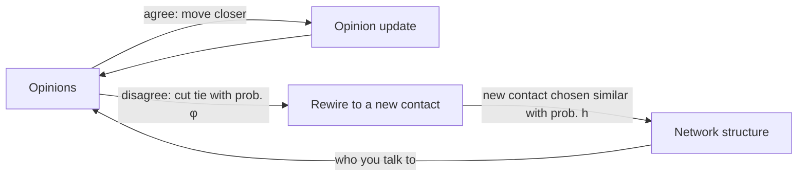

# When Social Choice Creates Social Polarization

### IE 305 Simulation Lab: Project Blueprint and Status Update

**Team:** Mihir Vasave, Vaibhav Mathur  |  **Tool:** AnyLogic  |  **Timeline:** 8 weeks, ~1 workday/week  |  **Document date:** 21 Oct 2026

---

## 0. Where we stand (honest status)

| Phase | Status |
|---|---|
| Problem framing, research question, hypotheses | Done (this document) |
| Literature review of the core models | Done (12 sources checked, see §9) |
| Mathematical model specification | Done (§3), not yet implemented |
| Experiment design and KPI definitions | Done (§6), not yet run |
| AnyLogic implementation | **Not started** (Week 1) |
| Results | **None yet.** Every outcome in this document is a hypothesis to be tested |

**Asks for the review:** (1) agree the scope in §3 is the minimum viable model, (2) confirm our AnyLogic licence includes Parameters Variation or Monte Carlo experiments (see §5 risks), (3) advise which single optional extension, if any, we should pick at the Week 6 gate.

---

## 1. Research question and hypotheses

**Central question.** Under what conditions do individual opinion updates plus adaptive tie-rewiring turn a connected, mixed population into a polarized and/or fragmented one?

We separate two things that are often conflated:

- **Opinion polarization:** the *distribution of opinions* splits into separated clusters.
- **Network fragmentation:** the *graph* splits into disconnected or weakly connected communities.

Each can happen without the other, so we measure both (§6.3).

**Testable hypotheses** (none assumed true):

| ID | Hypothesis |
|---|---|
| H1 | With no rewiring (φ = 0), the model reproduces known bounded-confidence behaviour: fewer final opinion clusters as tolerance d rises. *(Verification target, not a novelty claim.)* |
| H2 | Adding rewiring (φ > 0) increases network fragmentation relative to φ = 0 at the same tolerance, at least for some range of d. |
| H3 | *Who you reconnect to matters:* rewiring toward similar agents (h = 1) fragments the network more than rewiring to random agents (h = 0) at equal φ. This isolates the "social choice" mechanism. |
| H4 | There is a threshold-like transition in rewiring propensity φ separating a connected regime from a fragmented one, and its location shifts with mean degree and tolerance. *(Exploratory; motivated by published coevolving-network results.)* |
| H5 (alternative) | At high tolerance, adaptivity has little effect because few edges are ever in disagreement. |

**Feedback loop at the heart of the model:**



---

## 2. What the literature gives us (and what it does not)

| Source | Finding we use | How it enters our model |
|---|---|---|
| Deffuant et al. (2000); Hegselmann & Krause (2002) | Bounded confidence: agents influence each other only if opinions are within a threshold; yields consensus, polarization or fragmentation depending on that threshold | Opinion-update rule (§3.3) |
| Holme & Newman (2006) | Discrete opinions; with probability φ an edge is rewired to a random agent of the *same* opinion, otherwise the agent copies a neighbour. For mean degree 4 and 10 holders per opinion the transition is at φ_c ≈ 0.458, where a giant community of like-minded agents appears (full text read; initial conditions were not tested in the paper) | Motivates φ as the control parameter; rewire-to-similar is the analogue of our h = 1 (but theirs is not conditional on disagreement) |
| Vazquez, Eguíluz, San Miguel (2008) | Binary-state coevolving voter model: below a critical rewiring rate the network stays connected, above it ends as two large components (giant ≈ N/2). Mean-field p_c = (μ−2)/(μ−1) overestimates: 2/3 theoretical vs ≈ 0.38 simulated at mean degree 4 | Mean degree as a swept factor; qualitative comparison only (threshold rises with mean degree); never quote the mean-field number as a target |
| Kozma & Barrat (2008) | **Nearly our model with h = 0**: adaptive Deffuant on an Erdős–Rényi graph, rewiring to a random non-neighbour only after a disagreement. Static transition near d ≈ 0.256 (k̄ = 10); adaptation shifts it to larger d, cuts cluster counts, and turns each opinion cluster into its own component (full text read) | Closest published relative; our reference model was checked against it (see LITERATURE_NOTES.md §2) |
| Nardini, Kozma, Barrat (2008) | Depending on the dynamics, rewiring can speed consensus, break the network apart, or sustain diverse groups for very long times | Reminds us the outcome is not guaranteed to be polarization |
| Sasahara et al. (2021) | Influence alone or unfollowing alone is very slow; both above 0.1 together give echo chambers much faster. Link-formation rules give comparable stable states, with similarity-based rules converging over twice as fast. The Twitter match is partly built in (stopping rule) | Supports our finding that h changes speed, not the end state; qualitative context only, not a validation target |
| Baumann et al. (2020, arXiv) | Adding radicalization dynamics, the transition from consensus to radicalized states is governed mainly by influence strength and topic controversialness | Defines what our MVP *cannot* produce (§7) |
| Flache et al. (2017) | Many theoretical influence models, few empirical tests | Justifies our "literature-informed, not empirically calibrated" stance |
| Bail et al. (2018) | Field experiment where exposure to opposing views increased polarization for some participants | Caveat: our model only has assimilative influence (§7) |
| Gross & Blasius (2008) | Review of adaptive networks and their shared dynamical themes | Framing and terminology |

**Three-way separation (required by the brief):**

| Category | Items |
|---|---|
| **Established in literature** | Bounded-confidence dynamics; coevolving-network transitions between connected and fragmented states; adaptation can both speed consensus and split networks |
| **Our modelling assumptions** | Continuous opinion in [0,1]; per-agent tolerance and susceptibility; rewiring initiated by the disagreeing agent; edge-count conservation; Poisson-clock activation |
| **Our hypotheses** | H2 to H5, in particular that homophilous *selection* (h) adds fragmentation beyond tie-cutting alone |

**Novelty, stated modestly.** Kozma & Barrat and Holme & Newman already study adaptive bounded-confidence or voter-type models. Our contribution is a controlled, replicated *simulation-methodology* study that (a) separates opinion polarization from network fragmentation, (b) isolates the selection parameter h, and (c) reports confidence intervals and sensitivity. It is not a new theory of polarization.

---

## 3. Minimum viable model

### 3.1 Agents and network

- N agents (baseline N = 300). Each agent *i* has:
  - opinion x_i ∈ [0,1], initial x_i ~ Uniform(0,1) (the standard Deffuant-style initialization)
  - tolerance d_i (confidence bound), baseline d_i = d for all i; heterogeneous version d_i ~ truncated Normal(d, 0.05) in sensitivity runs
  - susceptibility μ_i, baseline μ_i = μ for all i
- Initial network: random graph with mean degree k₀ (baseline 8), built with AnyLogic's built-in network setup. Alternatives (small-world) are sensitivity runs.

### 3.2 Parameters

| Symbol | Meaning | Baseline | Swept range | Source of value |
|---|---|---|---|---|
| N | population size | 300 | 100, 300, 600 | Assumption (tractability) |
| k₀ | initial mean degree | 8 | 4, 8, 16 | Assumption; swept |
| d | tolerance (confidence bound) | 0.3 | 0.1 to 0.5 | Swept; range chosen to span the fragmentation-to-consensus transition seen in the bounded-confidence literature (to be located in V&V, §6.5) |
| μ | susceptibility | 0.3 | 0.1, 0.3, 0.5 | Deffuant allows 0 to 0.5 (0.5 means full averaging); value is an assumption |
| φ | probability of cutting a tie after a disagreement | 0.25 | 0 to 1 | Swept |
| h | probability the new tie is chosen among *similar* agents (else uniform) | 1.0 | 0, 0.5, 1 | Swept; our adaptation |

### 3.3 Dynamics (one activation)

Time advances in sweeps; one sweep is N random activations (random sequential updating). At each event:

```
pick agent i uniformly at random
if i has no neighbours: stop (nothing to do)
pick neighbour j uniformly among i's neighbours
Δ = |x_i − x_j|

if Δ < d_i:                              # agree enough: influence
    x_i ← x_i + μ_i · (x_j − x_i)
    if Δ < d_j:  x_j ← x_j + μ_j · (x_i_old − x_j)
else:                                    # disagree
    with probability φ, and only if j has more than one neighbour (so no agent is ever isolated):
        remove edge (i, j)
        with probability h:  choose k uniformly among non-neighbours of i with |x_k − x_i| < d_i
                             (if none exist, choose k uniformly among non-neighbours)
        else:                choose k uniformly among non-neighbours of i
        add edge (i, k)
    else: nothing happens
```

Properties by design: total edge count is conserved (mean degree stays k₀); φ = 0 recovers static bounded confidence; h = 0 isolates pure tie-cutting.

### 3.4 Stopping and warm-up

- **Frozen state:** max opinion change over the last W sweeps < ε (ε = 10⁻⁴, W = 20), and, when φ > 0, no edge remains with |x_i − x_j| ≥ d_i.
- **Cap:** t_max = 5,000 sweeps; runs that hit the cap are flagged *censored* and reported separately.
- With no noise term the system has absorbing states, so end-state KPIs are well defined. Noise is an optional extension (§7).

---

## 4. Data and parameter plan

**Decision: no empirical data collection.** The research question is about *mechanism* (conditions under which feedback produces fragmentation), so a literature-informed synthetic population is defensible. Collecting real network data would cost weeks and would not identify our parameters anyway.

| Item | Treatment |
|---|---|
| Initial opinions | Synthetic: Uniform(0,1) baseline; a bimodal-Beta and a Normal initialization as sensitivity checks |
| Initial network | Synthetic random graph; small-world as sensitivity check |
| d, μ, φ, h | **Swept, not calibrated.** We do not claim any value is validated against real behaviour |
| Behavioural validation | Qualitative comparison to published model outcomes only (Deffuant, Kozma & Barrat, Sasahara, Vazquez) |
| Uncertainty documentation | Parameter table with a "source / assumption / swept" column, kept up to date; all results reported over ranges with CIs |

Empirical data could only be used to *test* qualitative patterns (for example, the Twitter data in Sasahara et al.), and that is out of scope.

---

## 5. AnyLogic implementation plan

**Approach:** agent-based model, with a single global event (not one timer per agent) driving activations.

| Element | Design |
|---|---|
| Agent type | `Person`: variables `opinion`, `tolerance`, `suscept` |
| Environment | `Main` holds the population and the network |
| Network representation | AnyLogic built-in connections. Initial network via the random network type then `applyNetwork()`. Dynamic changes via `connectTo`, `disconnectFrom`, `isConnectedTo`, `getConnections`, `getRandomConnectedAgent` (all documented in the AnyLogic help) |
| Event | One recurring event in `Main` with exponential inter-event time (rate N), calling `activate()` on a random agent |
| Parameters | N, k₀, d, μ, φ, h, seeds, ε, W, t_max on the experiment |
| Random draws | Initial opinions, network, activations, tie-cut coin, partner choice, each from `uniform()` or equivalent on a seeded generator |
| Outputs | Time series (opinion histogram, variance, cluster count, giant-component fraction) sampled every 10 sweeps, plus end-state KPIs to CSV/Excel per replication |

**Technical risks to flag:**

| Risk | Mitigation |
|---|---|
| **No built-in metrics for components, modularity, or opinion clusters** | Write them in Java inside `Main` (union-find for components, O(N+E)). Unit-test on tiny hand-built graphs in Week 2 |
| Modifying a connection list while iterating over it | Copy `getConnections()` into a new list before changing links |
| Candidate search for "similar non-neighbour" is O(N) per rewire | Fine at N ≤ 600; avoid premature optimisation |
| Animation slows runs with dynamic links | Use animation only for screenshots; run experiments headless |
| Seed control and common random numbers | Use separate seeded streams for initialization and dynamics, so the same replication index gives the same initial population across scenarios. Confirm the exact seeding API in the AnyLogic docs |
| **Licence:** Parameters Variation and Monte Carlo experiments may not exist in the free PLE edition *(not verified)* | Check this week. Fallback: a custom experiment with a Java loop over scenarios and replications |

---

## 6. Experiments and analysis

### 6.1 Experiments (a small number, deliberately)

| Exp | Purpose | Factors | Runs |
|---|---|---|---|
| **A** | Does adaptivity change outcomes? (H1, H2, H4, H5) | d ∈ {0.1, 0.2, 0.3, 0.4, 0.5} × φ ∈ {0, 0.1, 0.25, 0.5, 0.75, 1}, h = 1 | 30 scenarios × 30 reps = 900 |
| **B** | Does *selection* matter? (H3) | h ∈ {0, 0.5, 1} × φ ∈ {0.25, 0.5, 1}, d at two values chosen from A | 18 scenarios × 30 reps = 540 |
| **C** | Sensitivity and robustness | One-at-a-time around the baseline: N, k₀, μ, tolerance heterogeneity, topology, initial opinion distribution | ~12 scenarios × 30 reps |

If Exp A shows a sharp change, add a finer φ grid near it. The replication count is checked, not assumed: run a 10-replication pilot, then use n ≈ (t·s / E)² for each key KPI with target half-width E (for example 0.05 on giant-component fraction).

### 6.2 Reproducibility and seeds

- Master seed recorded; replication *r* uses seed(r) for initialization and a derived seed for dynamics.
- The same *r* is reused across scenarios (common random numbers), so scenario differences are paired differences with tighter CIs.
- Reproducibility check: rerun 5 random scenario/replication pairs from stored seeds and confirm identical outputs.

### 6.3 KPIs: separating polarization from fragmentation

| Dimension | KPI | Definition |
|---|---|---|
| Opinion polarization | Opinion variance | Var(x) at end |
| | Number of major opinion clusters K | Sort opinions, split at gaps > 0.05, count clusters holding ≥ 5% of agents |
| | Cluster separation | Gap between the two largest clusters (if K ≥ 2) |
| Network fragmentation | Giant-component fraction S | \|largest component\| / N |
| | Number of components C and isolated fraction | From union-find |
| Alignment of the two | Cross-cluster edge fraction | Edges joining agents in different opinion clusters |
| | Modularity Q of the opinion-cluster partition | Newman modularity of the network under that partition |
| Dynamics | Time to frozen state; censoring rate | From stopping rule |

**Regime classification** (the key analytical product):

| | Network connected (S ≥ 0.9) | Network fragmented (S < 0.9 or ≥ 2 large components) |
|---|---|---|
| **One opinion cluster (K = 1)** | Consensus | Fragmented but agreeing |
| **Two or more opinion clusters (K ≥ 2)** | Polarized, still linked (cross-cluster edges persist) | **Echo-chamber regime** (polarized and fragmented, low cross-cluster edge fraction, high Q) |

We report, for each scenario, the *probability of each regime* with Wilson 95% intervals, plus means and t-based 95% CIs for continuous KPIs. Thresholds (0.05 gap, 5% size, S = 0.9) are themselves varied in a robustness check so conclusions do not hinge on them.

### 6.4 Sensitivity analysis

One-at-a-time sweeps (Exp C) first. If time allows, a Latin hypercube over (d, φ, h, μ, k₀) with regression on KPIs. Interactions we expect to matter: d × φ and φ × k₀.

### 6.5 Verification and validation

| Check | Type | Pass criterion |
|---|---|---|
| Edge count constant over time | Verification | Exactly conserved in every run |
| No self-loops or duplicate edges | Verification | Zero violations |
| KPI code on small hand-built graphs | Verification | Matches hand calculation |
| φ = 0 | Verification and V1 | Network unchanged; opinion clusters shrink in number as d rises (qualitative match to Deffuant; locate the consensus threshold in our runs and compare with the published figures *before* quoting any number) |
| d large | Verification | Consensus in all runs |
| φ = 1, h = 1 | Verification | Opinions mostly frozen; clusters trace initial structure |
| Qualitative match to Kozma & Barrat and Sasahara | V2 (behavioural) | Adaptation produces cluster formation and splitting; unfollowing-like rewiring produces segregation |
| *Optional:* binary-opinion voter mode vs Vazquez et al. | V3 | Fragmentation near the *simulated* critical rewiring rate (≈ 0.38 at mean degree 4 in their paper); the mean-field formula overestimates it, so do not use it as the target; costs about half a day, include only if ahead of schedule |

---

## 7. Weaknesses, confounds, and alternative explanations

| Issue | Why it matters | What we do |
|---|---|---|
| **Bounded confidence already fragments opinions with no rewiring** | Opinion splitting may not be an "adaptive network" effect at all | Always compare against the φ = 0 baseline (Exp A column 1) |
| Isolated agents | The cut partner could lose all ties, creating isolates that inflate "fragmentation" | Cuts that would isolate the partner are forbidden (§3.3), which also keeps the edge count exactly constant; isolated fraction is still reported |
| Finite size and initial conditions | Flache et al. report that outcomes depend on the initial opinion distribution and variance; N = 300 is small | Test N ∈ {100, 300, 600}; test other initial distributions; vary the initial network |
| Measurement thresholds | Cluster gap and S cutoffs are arbitrary | Robustness sweep on thresholds |
| **No true "radicalization"** | Assimilative bounded confidence cannot push opinions to the extremes; Baumann et al. need a reinforcing mechanism | State plainly: our model yields *clustering*, not extremism |
| **No repulsive influence** | Bail et al. suggest exposure can backfire; we model only attraction | Listed as a limitation; candidate extension |
| Parameter identifiability | d, φ, h, μ jointly shape outcomes and cannot be estimated from our data | Present results as regime maps over ranges, never as predictions |
| Stylization | Edge conservation, uniform activation, no platform algorithm | Frame insights as *mechanism and design-lever* findings, not policy evidence |

**Decision-oriented framing (IEOR angle):** treat h (how homophilous recommendations are) and d (how open agents are) as design levers, and ask which settings keep the giant component above a target while limiting opinion clustering. This is a comparison across scenarios in a stylized model, not a forecast.

**Optional extensions (pick at most one at the Week 6 gate):** (a) opinion noise (note Diakonova et al. find that noise changes the nature of the transition), (b) triadic closure for new ties, (c) heterogeneous activity rates, (d) a repulsion rule.

---

## 8. Eight-week plan (about one workday per week)

| Week | Work | Deliverable |
|---|---|---|
| 1 | Finalize spec; set up repo and seed protocol; AnyLogic skeleton: `Person`, network init, opinion update on a static network | Running model with opinion-trajectory plot |
| 2 | Add rewiring, global event, isolate rule; implement KPIs in Java; unit tests on small graphs | **Milestone M1: Minimum viable model complete** |
| 3 | Verification and V1/V2 checks; choose warm-up and run length; set ε, W, t_max | One-page V&V report |
| 4 | Experiment harness, CSV output, seed control; 10-replication pilot to set replication count | Pipeline + pilot variances. **Mid-project review** |
| 5 | Run Exp A and B (full replications) | Raw data, first heatmaps |
| 6 | Exp C sensitivity; regime classification; CIs; decision on one optional extension | Regime map draft |
| 7 | Final figures (heatmaps, regime maps, network snapshots, example trajectories); reproducibility check from seeds | Figure set + insights list |
| 8 | Report and presentation; buffer for reruns | Final report and talk |

**Dependencies:** KPIs (W2) before any experiments; V&V (W3) before pilots; pilot (W4) before replication counts. **If we fall behind:** drop Exp C to one-at-a-time on three factors and skip the optional extension and V3.

**Priority order if time is tight:** M1 model → V&V → Exp A → Exp B → sensitivity → everything else.

---

## 9. References

*Verification status: "checked" means the title, authors, venue and link were confirmed from the listed source in this session. Items marked "details from memory" still need a quick check against the publisher page.*

1. Holme, P. & Newman, M.E.J. (2006). Nonequilibrium phase transition in the coevolution of networks and opinions. *Phys. Rev. E* 74, 056108. DOI: [10.1103/PhysRevE.74.056108](https://doi.org/10.1103/PhysRevE.74.056108); arXiv: [physics/0603023](https://arxiv.org/abs/physics/0603023). *Checked.*
2. Vazquez, F., Eguíluz, V.M. & San Miguel, M. (2008). Generic absorbing transition in coevolution dynamics. *Phys. Rev. Lett.* 100, 108702. DOI: [10.1103/PhysRevLett.100.108702](https://doi.org/10.1103/PhysRevLett.100.108702); arXiv: [0710.4910](https://arxiv.org/abs/0710.4910). *Checked.*
3. Kozma, B. & Barrat, A. (2008). Consensus formation on adaptive networks. *Phys. Rev. E* 77, 016102. arXiv: [0707.4416](https://arxiv.org/abs/0707.4416). *Checked (DOI not seen).*
4. Nardini, C., Kozma, B. & Barrat, A. (2008). Who's talking first? Consensus or lack thereof in coevolving opinion formation models. *Phys. Rev. Lett.* 100, 158701. DOI: [10.1103/PhysRevLett.100.158701](https://doi.org/10.1103/PhysRevLett.100.158701). *Checked.*
5. Deffuant, G., Neau, D., Amblard, F. & Weisbuch, G. (2000). Mixing beliefs among interacting agents. *Advances in Complex Systems* 3. *Title and authors checked; journal volume and pages from memory.*
6. Hegselmann, R. & Krause, U. (2002). Opinion dynamics and bounded confidence: models, analysis and simulation. *JASSS* 5(3), 2. [https://www.jasss.org/5/3/2.html](https://www.jasss.org/5/3/2.html). *Checked.*
7. Sasahara, K., Chen, W., Peng, H., Ciampaglia, G.L., Flammini, A. & Menczer, F. (2021). Social influence and unfollowing accelerate the emergence of echo chambers. *J. Comput. Soc. Sci.* 4. DOI: [10.1007/s42001-020-00084-7](https://doi.org/10.1007/s42001-020-00084-7); arXiv: [1905.03919](https://arxiv.org/abs/1905.03919). *Checked.*
8. Baumann, F., Lorenz-Spreen, P., Sokolov, I.M. & Starnini, M. Modeling echo chambers and polarization dynamics in social networks. arXiv: [1906.12325](https://arxiv.org/abs/1906.12325). *Preprint checked; journal version (Phys. Rev. Lett., 2020) from memory.*
9. Flache, A., Mäs, M., Feliciani, T., Chattoe-Brown, E., Deffuant, G., Huet, S. & Lorenz, J. (2017). Models of social influence: towards the next frontiers. *JASSS* 20(4), 2. DOI: [10.18564/jasss.3521](https://doi.org/10.18564/jasss.3521). *Checked.*
10. Gross, T. & Blasius, B. (2008). Adaptive coevolutionary networks: a review. *J. R. Soc. Interface* 5, 259–271. DOI: [10.1098/rsif.2007.1229](https://doi.org/10.1098/rsif.2007.1229). *Checked.*
11. Diakonova, M., Eguíluz, V.M. & San Miguel, M. (2015). Noise in coevolving networks. *Phys. Rev. E* 92, 032803. *Checked.*
12. Bail, C.A. et al. (2018). Exposure to opposing views on social media can increase political polarization. *PNAS.* DOI: [10.1073/pnas.1804840115](https://doi.org/10.1073/pnas.1804840115). *Checked.*
13. AnyLogic Help: Connections and networks. [https://anylogic.help/anylogic/agentbased/connections-and-networks.html](https://anylogic.help/anylogic/agentbased/connections-and-networks.html). *Checked.*

---

## 10. First work session checklist (Week 1)

- [ ] Confirm AnyLogic edition and which experiment types are available
- [ ] Create a shared repo or folder; add the parameter table from §3.2 as `PARAMETERS.md`
- [ ] Verify the two "from memory" references (#5, #8) on the publisher pages
- [ ] Build `Person` agent and `Main` with N, d, μ as parameters
- [ ] Initialise a random network with k₀ = 8; confirm mean degree with a quick check
- [ ] Implement the opinion update on the static network (φ = 0)
- [ ] Plot opinion trajectories; compare qualitatively with the Deffuant description
- [ ] Decide seed protocol: master seed, per-replication seed, separate streams
- [ ] Agree who owns what: suggested split is *Mihir: model and dynamics; Vaibhav: KPIs, experiments, analysis scripts*, adjust as you prefer

---

## 11. Presenter script: what we say, in plain words (about 8 to 10 minutes)

*Speak this, don't read it. Scroll the sections named in brackets as you go. Everything here is true only if both of us have skimmed the abstracts of the papers we name.*

**Opening [§0]**
"Quick status first. We've finished the scoping stage: the research question, a literature review, a full model specification and an experiment design. We haven't built anything in AnyLogic yet. We'd like your feedback on the scope before we start building."

**The question [§1]**
"We're asking whether a mixed, connected group of people can end up polarized and split into separate communities, just because each person makes small choices about who to listen to and who to stay connected with. There are two different things that can happen: the opinions can split into camps, or the network itself can break apart. They don't always go together, so we measure both. And we're not assuming it will happen. It's a hypothesis, and one of our hypotheses is that adaptation might not matter at all."

**What we read [§2]**
"We went through the main families of models. The Deffuant and Hegselmann-Krause models give us the idea that people only get influenced by others whose opinions are already fairly close. Holme and Newman, and Vazquez and co-authors, study networks where opinions and links change together, and they show a single rewiring parameter can flip the system between connected and fragmented. Kozma and Barrat did the adaptive version of Deffuant, so that's our closest comparison. Sasahara and co-authors showed that influence plus unfollowing quickly produces echo chambers, and it matched Twitter data, so we use that as a qualitative check.

Two cautions came out of it. Flache and co-authors point out that this field has far more theory than empirical testing, so we won't claim our parameters are validated. And Bail's field experiment found that seeing opposing views can backfire for some people, but our model only has people moving closer, so that's a limitation we state.

So the mechanism isn't new. Our contribution is a controlled, replicated study that separates the two outcomes and isolates the effect of choosing similar people when reconnecting."

**Data and distribution choice [§4]**
"We aren't collecting real data. Our question is about mechanism, and real data wouldn't tell us values like tolerance or rewiring probability anyway. We generate a synthetic population. Opinions start uniform between 0 and 1, because that's the convention in the Deffuant and Hegselmann-Krause papers, so we can check our model against theirs, and it represents a properly mixed starting population. It isn't empirically justified, and we say so. To make sure our conclusions don't depend on it, we also try a start centred in the middle and a start that's already two-sided. The network starts as a random graph with a set average number of links, with small-world and scale-free versions as checks. The parameters are swept over ranges, never calibrated."

**The model [§3]**
"Each agent has an opinion, a tolerance, and a susceptibility, meaning how far they move. Every step, a random agent picks a random neighbour. If their opinions are within the tolerance, they move toward each other. If not, then with some probability the agent drops that link and connects to someone new. We control how often the new contact is someone with a similar opinion. The total number of links stays constant, so the average degree doesn't drift.

If rewiring is switched off, this is the standard bounded-confidence model, and that's our verification baseline. If we make the new contact random instead of similar, we isolate cutting ties from choosing similar people. A run ends when opinions stop changing and no disagreeing links are left, or at a time cap, and runs that hit the cap are reported separately. What's established is bounded confidence and the connected-to-fragmented transitions. What's ours is this specific rewiring rule and the separate 'choose similar' parameter."

**Experiments [§6]**
"Three experiments. The first varies tolerance against rewiring probability, about thirty scenarios with thirty repeats each, to see whether adaptation changes anything compared with no rewiring. The second tests whether choosing similar contacts matters beyond just cutting ties. The third checks sensitivity to population size, average links, starting distribution and network type. We'll run a small pilot first to decide how many repeats we really need instead of assuming thirty.

Random seeds are recorded, and we reuse the same starting populations across scenarios so comparisons are tighter. For every run we record how spread out the opinions are, how many opinion clusters there are, and what fraction of people are in the biggest connected group. Then we sort each run into one of four outcomes: consensus, polarized but still connected, fragmented but agreeing, or polarized and fragmented, which we call the echo-chamber case. We report how likely each outcome is, with confidence intervals. For verification, we check that the number of links never changes and that with rewiring off we match known bounded-confidence behaviour."

**Limitations [§7]**
"The main caveat is that bounded confidence already splits opinions with no rewiring, so we always compare against that. The model can make clusters but not extremism, because nothing pushes people outward. So our results show what the mechanism can do in a simplified model, not what real populations do."

**Plan and ask [§8, §10]**
"Eight weeks: a working model by week 2, verification in week 3, pilot and experiment setup in week 4, main experiments in weeks 5 and 6, and figures and write-up in weeks 7 and 8. If we fall behind, we cut the sensitivity experiment first. This week we start building the agents and the network in AnyLogic. Two questions for you: is this the right scope for the course, and do you know whether our AnyLogic edition supports parameter-variation or Monte Carlo experiments?"

### If they ask

- **Why Uniform?** "It's the convention in the source papers, so we can compare against them, and it represents a mixed start. We test other starting distributions to check robustness."
- **Where's the update rule from?** "Deffuant for the bounded-confidence update. The rewiring part is our own adaptation, informed by Kozma and Barrat."
- **Isn't this already done?** "The mechanism, yes. Our contribution is the controlled comparison and separating polarization from fragmentation."
- **Where do the parameter values come from?** "They're swept, not calibrated. We make no claim they match real people."
- **How will you know it's right?** "Edge count must stay constant, we must match known behaviour with rewiring off, and results should qualitatively match the published adaptive-network papers."
- **Anything we haven't worked out:** "We haven't looked into that yet. We'll check and come back to you." Don't make up numbers.
