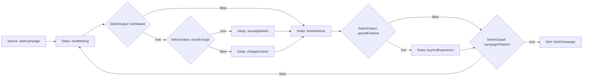

# Lab-style flowchart version: what changed and what still uses code

Open **CampusProductLaunch_LabFlowchart.alp**. This is a separate review version. The two previously tested models remain byte-identical and are the rollback. The first revision was imported/compiled/run locally, as evidenced by its generated AnyLogic sources/classes and actual product_lab_output CSVs. Those default outputs match Java. The corrected top-left/runtime-icon layout still needs an editor/display check; prior execution does not establish its rendering.

## Based on the elements actually used in your handouts

The local course files `Downloads/Simulasun/A1-Intro_AnyLogic (1).pdf`, `A2A-MoreModeling_2026.pdf` and `A2-ResourcePool-Priorities_2026.pdf` teach Process Modeling Library models. The second includes a SelectOutput decision/rework loop; the others use Source, Delay/Service and Sink. No statecharts or advanced library were assumed to have been taught. The handouts are not redistributed.

This version uses **Source, Delay, SelectOutput and Sink**, plus ordinary named Function elements for short rules. No resource pool or service queue is invented: this application has no actual service-resource constraint.

## Where to find the elements

In Projects, double-click **Main**. The connected palette blocks now occupy the top-left of Main (approximately y=100–400). Named rule functions are below them; the network presentation is grouped underneath at y=650. Explicit native icon presentations and connector views are included in the running display as well. The earlier revision placed blocks out of view and omitted runtime icons; that layout mistake is corrected in this revision. Click a block to inspect its condition, delay or action in Properties.

The source creates **one control token**. It schedules the campaign's encounters; it is not a new customer. The actual 300 Consumer agents remain the population on the network. The result is a hybrid agent-based model with a process-flow scheduler, not a model of customers arriving at a shop.

## What each block actually controls

| Block | Property/action | Meaning |
|---|---|---|
|startCampaign (Source)|Manual; one token injected at startup|Start the control loop once|
|nextMeeting (Delay)|0.005 model time; `chooseMeeting(); shareLaunchNews();` in On at exit|Select customer/contact and handle news transmission|
|bothAware (SelectOutput)|`canDiscuss`|Skip averaging/reconnection unless the encounter permits product discussion|
|closeEnough (SelectOutput)|`abs(beforeI-beforeJ) < d`|Route to averaging or possible contact replacement|
|averageBeliefs (Delay)|Zero duration; `moveBeliefsCloser();`|Apply the two symmetric averaging equations|
|changeContact (Delay)|Zero duration; `replaceContact();`|Apply the replacement chance and random/similar candidate rule|
|finishAttempt (Delay)|Zero duration; `countAttempt();`|Record after-values and count the attempt|
|periodFinished (SelectOutput)|Attempt count equals300|Only at this boundary perform the buying round|
|buyAndExperience (Delay)|Zero duration; `checkPurchases();`|Identify eligible buyers together, then reveal their experiences|
|campaignFinished (SelectOutput)|Period60 and attempt count reset|End after the last buying round; otherwise loop|
|finishCampaign (Sink)|Export, finish simulation|Dispose of the control token and stop|

Actions use **On at exit**, before downstream SelectOutput conditions are evaluated; using On exit for these state changes would route using stale values. This follows the official SelectOutput routing documentation.

The 0.005 delay paces each attempt: ten attempts use0.05, matching the old visual tick. Zero-duration delays are action stages, not assumed customer processing times. Deterministic SelectOutput conditions use random draws already generated for the model, so the library does not introduce fresh policy randomness.

## How much Java remains? Be explicit

This is **not a no-code model**. Adding palette shapes without moving the decisions into them would be cosmetic. Here the connected blocks really choose the discussion branch, period boundary and stop condition. The old `interaction`, `stepActivation`, `stepPeriod` and Main event loop are removed from this version; the flow performs those roles.

Seven visible Function elements contain the behavioral arithmetic and contact selection, totaling79 nonblank-source lines as currently serialized. The belief-averaging function has four lines. Selection, replacement and simultaneous buying require loops/conditions and are longer. Click each Function to read one rule at a time.

There is still substantial inherited custom support (about262 source lines) for generating the network/customer data, displaying the network/metrics, accounting, invariants and CSV export. That support was not taught as drag-and-drop modeling. It is retained to preserve the tested research model and results; do not describe the entire project as made only from elementary lab blocks or as entirely student-written.

A genuinely near-zero-code process model would require simplifying the adaptive-network/opinion mechanism and rerunning the analysis. Existing numerical results cannot automatically be attached to a different simpler model. The present file improves inspectability and teaches the real decisions; it does not silently change the research question to avoid code.

## Checks completed

- XML structure, unique IDs, library reference,11 block declarations and14 connectors checked.
- Seven function bodies plus customer/display support compile against the installed AnyLogic8.9.10 Agent/shape/Source APIs.
- A harness traverses the **serialized block connector graph**, evaluates the actual conditions and executes the actual action text. Across36 policies ×2 seeds (72 cases), all61×23 period metrics and final customer beliefs, awareness/purchase periods and network edges match the original Java kernel.
- The harness does **not** execute the actual PML scheduling engine or verify editor import. No new engine run has been invented. The previous screenshots verify previous files, not this file.

Evidence: `sim/lab_flowchart_build.json`, `sim/lab_flowchart_checks.json`. This version deliberately supports individual policies0–35 only; it does not offer the old automatic batch option36.

## One editor check still needed

Open the new file, inspect Main's actual palette blocks, and run Simulation with defaults6/1000 once. Expected final result is300 aware,148 paid,12 free,Rs19,200 profit. Output goes to `product_lab_output`, separate from earlier exports. Preserve the exact message if import, compilation or runtime fails.

Until that run succeeds, use the original tested model for any required runnable submission. The existing final submission ZIP is not silently replaced by this untested review file.

Official block references: [Source](https://anylogic.help/library-reference-guides/process-modeling-library/source.html), [SelectOutput](https://anylogic.help/library-reference-guides/process-modeling-library/selectoutput.html). Installed library example schemas were inspected for element/connector serialization; no example market logic was copied into the application.
